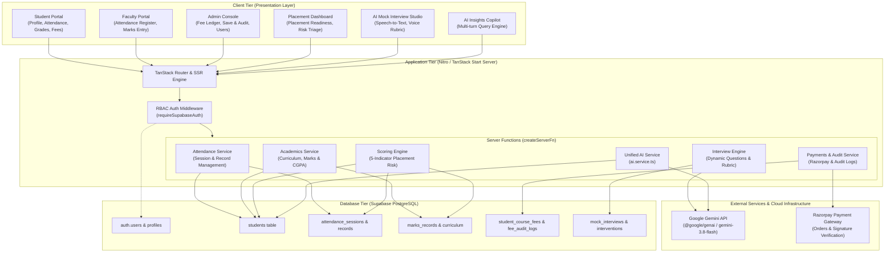
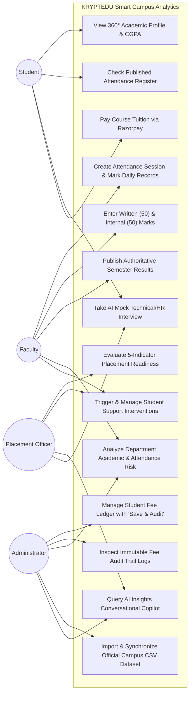
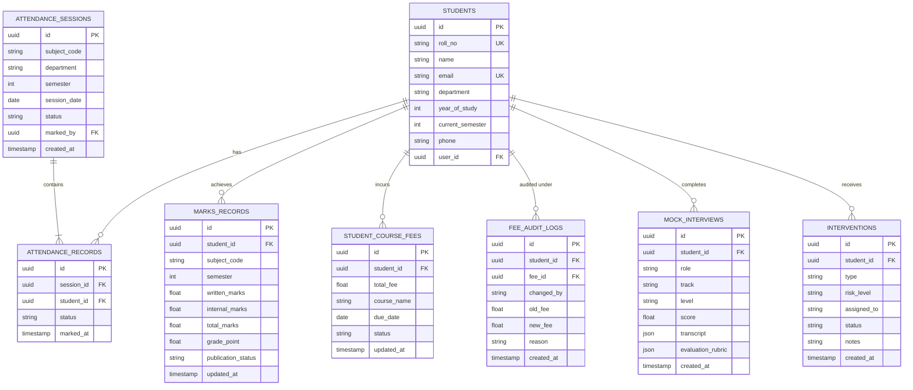
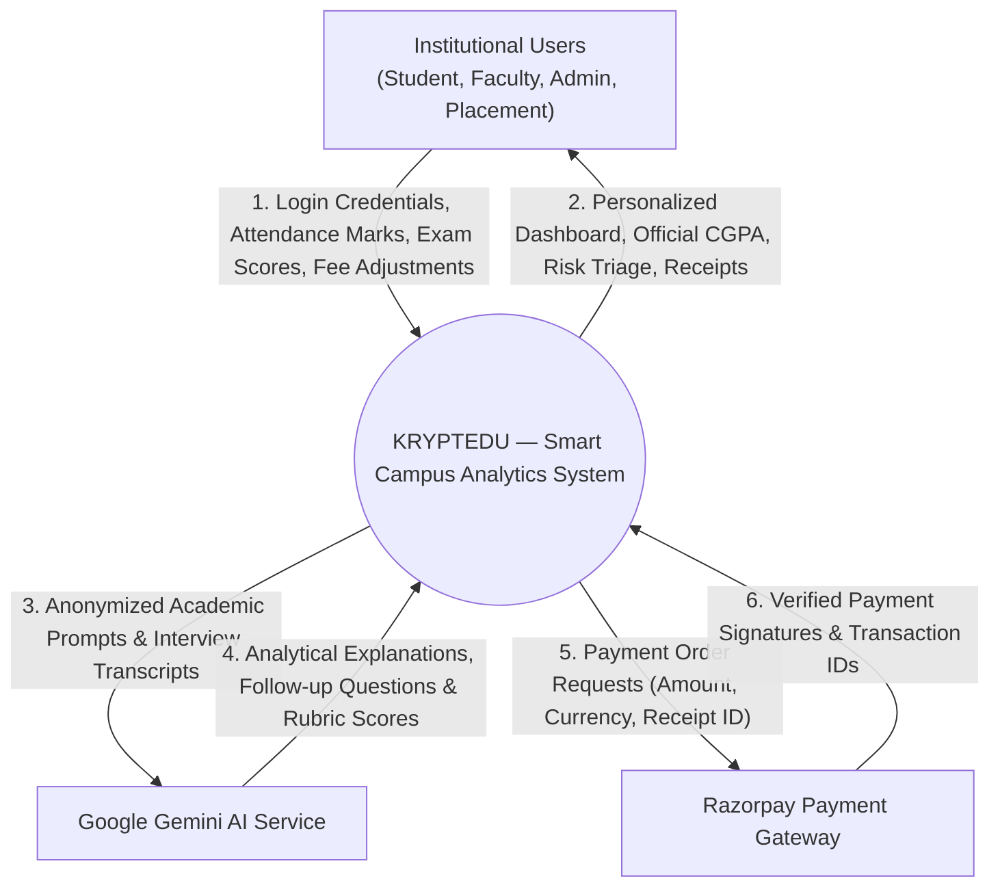
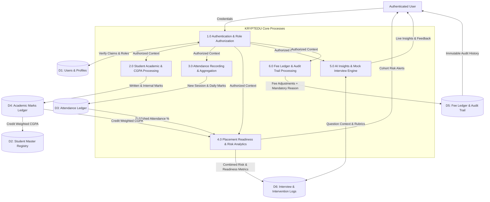
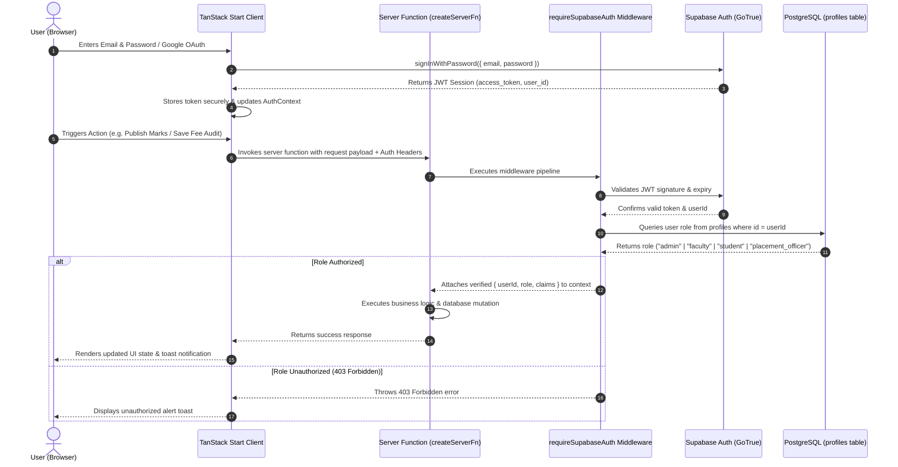
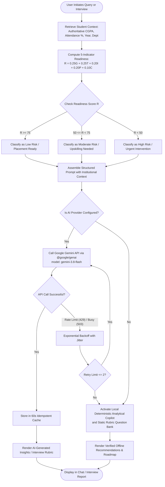
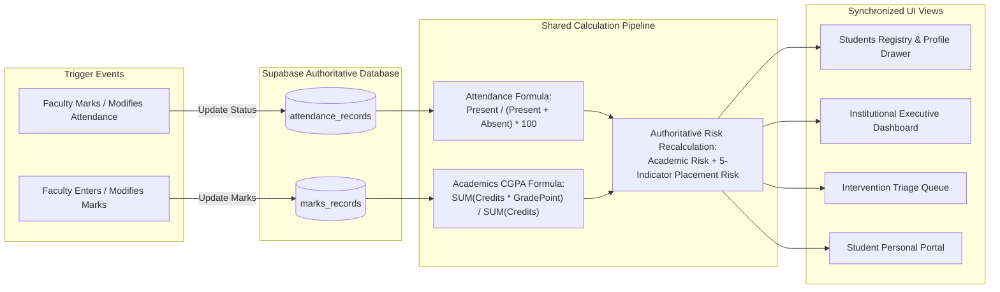
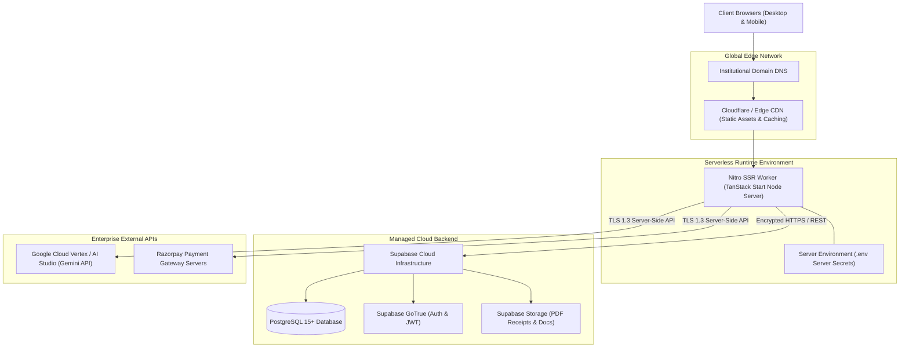

# KRYPTEDU — Project Diagrams & Architectural Models

This document compiles the formal architectural diagrams, structural blueprints, and behavioral workflows for **KRYPTEDU — Smart Campus Analytics**, modeled directly on the verified implementation.

---

## 1. System Architecture Diagram

---

## 2. Use Case Diagram

---

## 3. Entity Relationship Diagram (ERD)

---

## 4. Data Flow Diagram Level 0 (Context Diagram)

---

## 5. Data Flow Diagram Level 1 (Subsystems Flow)

---

## 6. Authentication & RBAC Sequence Diagram

---

## 7. AI Insights & Placement Readiness Workflow Diagram

---

## 8. Attendance and Academics Two-Way Sync Workflow

---

## 9. Production Deployment Architecture Diagram

