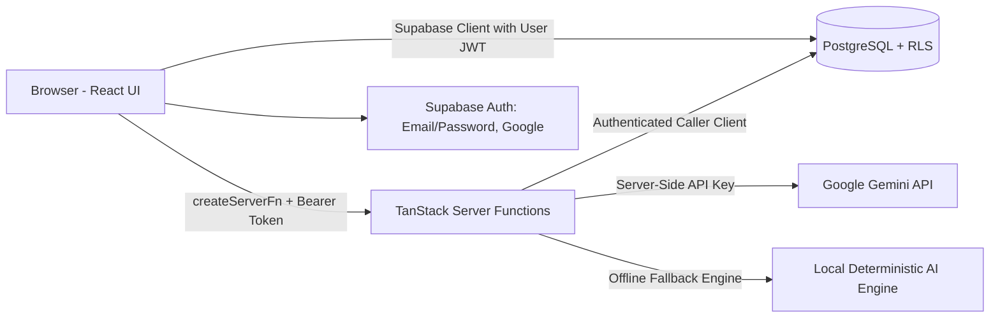

# KRYPTEDU — Smart Campus Analytics

> **Understand. Predict. Improve Student Success.**  
> Built for **KPMG India Challenge 04**.

KRYPTEDU brings a student's academic performance, attendance, learning-platform (LMS) activity, campus engagement, and placement preparation into one unified, intelligent platform. It calculates an explainable Student Success Score, flags academic and placement risks with root-cause feature attributions, segments cohorts into actionable quadrants, tracks support interventions, and provides two enterprise-grade AI capabilities: a conversational **AI Insights Copilot** and an interactive **Mock Interview Studio**.

---

## Table of contents

- [Overview](#overview)
- [Key features](#key-features)
- [Student Success Score methodology](#student-success-score-methodology)
- [User roles](#user-roles)
- [Architecture and technology stack](#architecture-and-technology-stack)
- [Database and data model](#database-and-data-model)
- [AI Insights](#ai-insights)
- [Mock Interview Studio](#mock-interview-studio)
- [Installation and local development](#installation-and-local-development)
- [Environment variables](#environment-variables)
- [Data import and expected formats](#data-import-and-expected-formats)
- [Security and privacy](#security-and-privacy)
- [Testing and verification](#testing-and-verification)
- [Deployment](#deployment)
- [Project structure](#project-structure)
- [Limitations and roadmap](#limitations-and-roadmap)
- [Contributing, license and acknowledgements](#contributing-license-and-acknowledgements)

---

## Overview

### The problem
Higher education institutions routinely store course grades, lecture attendance, LMS engagement logs, campus activities, and placement assessment results across disparate, siloed systems. Because faculty and leadership lack a holistic view, students encountering compound difficulties across multiple dimensions often go unnoticed until academic probation or recruitment failure becomes unavoidable.

### The solution
KRYPTEDU synthesizes multidimensional student indicators into an actionable intelligence pipeline:

- Computes a deterministic, explainable **Student Success Score** (0–100);
- Classifies **academic risk** and **placement risk** (High / Medium / Low) with directional feature attribution explaining the root cause;
- Dynamically segments cohorts across Academic × Placement quadrants and groups them into 5 targeted **support groups**;
- Facilitates the creation, assignment, tracking, and auditing of **interventions**;
- Delivers a conversational, multi-turn **AI Insights Copilot** that answers complex cohort queries grounded directly in institutional data;
- Empowers students to practice with an AI-powered **Mock Interview Studio** with deduplicated question sets and rubric-based evaluations.

### Intended users
Administrators, faculty members, placement officers, and students. Every role is strictly scoped via PostgreSQL Row Level Security (RLS) policies.

### Current status

| Capability | Status |
|---|---|
| Email/password and Google OAuth sign-in, pending-approval workflow, RBAC | Implemented |
| Institutional dashboard, student directory, detailed student profile, risk explanations | Implemented |
| Cohort analytics, 4-quadrant segmentation, and clickable support groups | Implemented |
| Interventions management (create, edit, reassign, status tracking, overdue filters) | Implemented |
| CSV ingestion with validation, duplicate detection, and import history | Implemented |
| Institutional reports (3 comprehensive CSV exports) | Implemented |
| Real-time notifications with per-user read/unread state persistence | Implemented |
| Conversational AI Insights Copilot | Implemented; multi-turn context retention, Mode A (grounded analytics) & Mode B (pedagogy), with verified local fallback engine |
| Mock Interview Studio | Implemented; role-tailored (4 roles × 3 difficulty levels), question deduplication, and rubric-based evaluations with session history |
| Student Dashboard | Implemented; strict student data isolation linked to `students.user_id` |

*The default demo dataset contains **36 synthetic student records** with zero personally identifiable information (PII).*

---

## Key features

1. **Authentication and Role-Based Access Control (RBAC):** Email/password and Google sign-in. New sign-ups receive a `pending` role until approved by an administrator.
2. **Specialized Dashboards:** Faculty and administrators access the institutional cohort dashboard (`/dashboard`), while students are automatically routed to their personal dashboard (`/student-dashboard`).
3. **Student Directory & Profiles:** Search by name or roll number, filter by department or risk level, sort by performance indicators, and inspect individual score breakdowns and risk factors.
4. **Explainable Student Success Score:** Composite weighted score (Academic 45%, Placement 35%, Engagement 20%) with proportional rescaling for missing data (see [methodology](#student-success-score-methodology)).
5. **Root-Cause Risk Indicators:** Academic and placement risk levels paired with plain-language contributing factors (e.g., *"Attendance below 75% (71%)"* or *"2 active backlogs"*).
6. **Cohort Analytics & Support Groups:** Scatter-plot segmentation, departmental ranking, and 5 one-click support groups (Urgent Support, Strong Academics / Low Placement, Good Academics / Poor Attendance, Placement-Ready / Low Risk, Insufficient Data).
7. **Interventions Management:** Create, assign, update, and resolve academic or placement interventions with priority levels and due dates.
8. **Data Integration:** Robust CSV ingestion engine across 6 categories with row-level validation, duplicate checking, and audit history.
9. **Conversational AI Insights:** Context-aware copilot supporting multi-turn dialogue, Mode A grounded cohort queries, Mode B pedagogical advice, and pronoun resolution (*"Why is it low?"*).
10. **Mock Interview Studio:** Practice technical and behavioral questions across Junior, Mid, and Senior tracks, with rubric-scored feedback, final performance summaries, and historical tracking.
11. **Reports & Notifications:** One-click CSV exports for at-risk cohorts, department rankings, and active interventions. Per-user notification tracking.
12. **Digital Student ID:** Flip-style digital student ID card featuring dynamic QR codes and academic standing indicators.
13. **User Administration:** Secure role assignment interface with safeguard constraints that prevent removing the last remaining administrator.

---

## Student Success Score methodology

All scoring logic is centralized in **[`src/lib/scoring.ts`](src/lib/scoring.ts)** and validated via Vitest (`src/lib/scoring.test.ts`). The dashboard, CSV exports, student profiles, and AI Insights consume these exact functions to guarantee 100% mathematical consistency across the entire platform.

```text
Success Score   = 0.45 × Academic Index + 0.35 × Placement Index + 0.20 × Campus Engagement

Academic Index  = 0.50 × (CGPA / 10 × 100) + 0.30 × Attendance + 0.20 × LMS Activity − (5 × Backlogs)
Placement Index = 0.50 × Placement Readiness + 0.30 × Skills Score + 0.20 × Feedback Score
```

Every metric is clamped to the range $[0, 100]$ and rounded to the nearest integer.

| Component | Default Weight | Evaluated Inputs |
|---|---|---|
| **Academic Index** | **45%** | CGPA, Class Attendance (%), LMS Activity, Active Backlogs |
| **Placement Index** | **35%** | Placement Readiness Score, Technical Skills Score, Mock Feedback Score |
| **Campus Engagement** | **20%** | Campus Activities & Engagement Score |

### Missing data handling
Scores of `0` (e.g., 0 backlogs or a genuine 0 on an assessment) are preserved as authentic performance data. Missing fields (`null` or `undefined`) trigger proportional weight rescaling across available indicators and flag the record with a data-completeness warning.

### Risk classification rules

| Dimension | High Risk | Medium Risk | Low Risk |
|---|---|---|---|
| **Academic Risk** | Academic Index $< 55$, **or** Backlogs $\ge 2$, **or** Attendance $< 60\%$ | Academic Index $< 70$, **or** Attendance $< 75\%$ | All other conditions |
| **Placement Risk** | Placement Index $< 45$ | Placement Index $< 65$ | All other conditions |

### Quadrants and support groups
- **4-Quadrant Segmentation:**
  - High Academic / High Placement (Academic $\ge 65$, Placement $\ge 60$)
  - High Academic / Low Placement (Academic $\ge 65$, Placement $< 60$)
  - Low Academic / High Placement (Academic $< 65$, Placement $\ge 60$)
  - Low Academic / Low Placement (Academic $< 65$, Placement $< 60$)
- **Actionable Support Groups:**
  - **Urgent Support:** High Academic Risk and High Placement Risk simultaneously.
  - **Strong Academics, Low Placement:** Academic Index $\ge 65$ with Placement Index $< 60$.
  - **Good Academics, Poor Attendance:** CGPA $\ge 7.0$ with Attendance $< 75\%$.
  - **Placement-Ready, Low Risk:** Low Academic Risk and Low Placement Risk.
  - **Insufficient Data:** Two or more required indicators are unrecorded.

---

## User roles

Roles are stored in the PostgreSQL `user_roles` table (mapped to the `app_role` enum: `admin`, `faculty`, `placement`, `student`, `pending`). Roles cannot be modified from client-side user metadata.

| Capability | Admin | Faculty | Placement Officer | Student |
|---|:---:|:---:|:---:|:---:|
| Read all student records | ✅ | ✅ | ✅ | Own record only |
| Read interview feedback scores | ✅ | ✅ | ❌ | Own only |
| Create & edit students, interventions, CSV imports | ✅ | ✅ | ✅ | ❌ |
| Delete student records | ✅ | ❌ | ❌ | ❌ |
| Read mock-interview session histories | ✅ | Own only | ✅ | Own only |
| Assign roles and list institutional accounts | ✅ | ❌ | ❌ | ❌ |
| Access staff pages (Dashboard, Analytics, Interventions, etc.) | ✅ | ✅ | ✅ | Redirected to `/student-dashboard` |

- **Admin:** Manages user approvals and role promotions (`set_user_role`, `get_all_users`), full visibility across academic and interview records. Last-admin protection is enforced in the database.
- **Faculty:** Analyzes academic performance, attendance trends, and LMS logs; manages interventions; and queries the AI Copilot. Cannot alter user roles.
- **Placement Officer:** Tracks placement readiness, technical skills, and mock interview trends across cohorts. Restrained by database policies from accessing confidential faculty feedback scores.
- **Student:** Isolated view of their own academic index, personalized risk factors, and intervention tasks. Accesses the Mock Interview Studio and personal interview logs.

---

## Architecture and technology stack

| Layer | Technology |
|---|---|
| **Framework** | **TanStack Start v1** (React 19, TypeScript), file-based routing via TanStack Router |
| **Bundler & Dev Server** | **Vite 8** |
| **Styling & Components** | **Tailwind CSS v4**, Radix UI primitives, Lucide Icons, Recharts |
| **Server Logic** | TanStack `createServerFn` server functions |
| **Database & Auth** | **Supabase** (PostgreSQL 15), Row Level Security (RLS) & Security Definer SQL functions |
| **AI Engine** | **Google Gemini** (`gemini-1.5-flash` via `@google/genai`), server-only with deterministic fallback |
| **Data Ingestion** | PapaParse CSV streaming parser with type validation |
| **Testing** | **Vitest 4** + React Testing Library |



---

## Database and data model

Migrations are maintained in `drizzle/migrations/`.

| Table | Purpose |
|---|---|
| `user_roles` | Single authoritative role per user (`admin`, `faculty`, `placement`, `student`, `pending`). RLS-protected. |
| `students` | Core student record: roll number, name, department, year, CGPA, attendance, LMS activity, engagement, placement readiness, skills, feedback, backlogs, and `user_id` mapping. |
| `interventions` | Student intervention tasks: title, category, priority, status, assigned_to, due_date, notes. |
| `data_imports` | Ingestion audit trail: category, filename, row count, status, error message. |
| `notification_reads` | Per-user read state tracking for notifications. |
| `interview_sessions` | Mock interview questions, user answers, rubric evaluations, score summaries, and overall status. |

---

## AI Insights

The **AI Insights Copilot** operates as an institutional analytics assistant:

- **Mode A (Authoritative Data Q&A):** Answers questions like *"Which department has the lowest placement readiness?"* or *"List all high-risk students in Computer Science"*. Data is scored with `scoring.ts` on the server and injected into the prompt. Hallucinated student records are strictly prevented.
- **Mode B (Pedagogy & General Advisory):** Answers educational questions like *"Explain the STAR method for our students"* or *"Provide a 30-day intervention turnaround plan for attendance deficits"*.
- **Multi-Turn Context & Pronoun Resolution:** Resolves follow-ups such as *"Why is it low?"* by analyzing the preceding conversational turns.
- **Model:** `GEMINI_MODEL`, defaulting to **`gemini-1.5-flash`**.
- **Resilient Fallback:** If `GEMINI_API_KEY` is not provided or the Gemini API is unreachable, the system activates a verified local deterministic conversational engine without throwing unhandled exceptions.
- **Security & Privacy:** API keys and raw system instructions are kept strictly server-side. Prompts are sanitized and responses are streamed safely.

---

## Mock Interview Studio

1. **Role Selection:** Software Developer, Data Analyst, AI/ML Engineer, or General Technical.
2. **Track & Difficulty:** Technical, HR/Behavioral, or Mixed across Junior, Mid, and Senior levels.
3. **Question Deduplication:** Tracks previously served question IDs in session storage to ensure questions do not repeat during practice.
4. **Structured Rubric Evaluation:**
   - **Technical Questions:** Assessed on correctness, technical depth, and problem-solving methodology.
   - **Behavioral Questions:** Assessed on clarity, relevance, and the STAR framework (Situation, Task, Action, Result).
5. **Session Persistence:** Full transcripts, evaluations, and overall performance summaries are saved to `interview_sessions` under the student's authenticated user ID.

---

## Installation and local development

### Prerequisites
- **Node.js** 20.x or newer
- **npm** (or **bun** / **pnpm**)

### Setup Instructions

```bash
# 1. Clone the repository
git clone https://github.com/<your-username>/<your-repo-name>.git
cd <your-repo-name>

# 2. Install dependencies
npm install

# 3. Create your local environment file
cp .env.example .env

# 4. Start the local development server
npm run dev
```

The application will be accessible at `http://localhost:8080/`.

### Available Scripts

| Task | npm command | Bun equivalent |
|---|---|---|
| **Development Server** | `npm run dev` | `bun run dev` |
| **Run Test Suite** | `npm run test` | `bun run test` |
| **Type Check** | `npx tsc --noEmit` | `bunx tsc --noEmit` |
| **Lint Codebase** | `npm run lint` | `bun run lint` |
| **Format Files** | `npm run format` | `bun run format` |
| **Production Build** | `npm run build` | `bun run build` |
| **Preview Build** | `npm run preview` | `bun run preview` |

---

## Environment variables

Configure your `.env` file based on `.env.example`. **Never commit your `.env` file to version control.**

| Variable | Scope | Purpose |
|---|---|---|
| `VITE_SUPABASE_URL` | Client & Server | Supabase backend URL |
| `VITE_SUPABASE_PUBLISHABLE_KEY` | Client & Server | Supabase anonymous publishable key |
| `VITE_SUPABASE_PROJECT_ID` | Client & Server | Supabase project identifier |
| `SUPABASE_URL`, `SUPABASE_PUBLISHABLE_KEY` | Server-only | Server function authorization verification |
| `GEMINI_API_KEY` (or `GOOGLE_API_KEY`) | **Server-only secret** | Optional: Google Gemini API key for live LLM responses |
| `GEMINI_MODEL` | Server-only (optional) | Gemini model override (defaults to `gemini-1.5-flash`) |

*Note: If `GEMINI_API_KEY` is omitted, the platform gracefully switches to its local deterministic conversational engine.*

---

## Data import and expected formats

The data integration engine supports bulk CSV uploads across 6 student dimensions:

- **Matching Key:** Every file must contain a `roll_no` column matching the student identifier.
- **Supported Dimensions & Columns:**
  - **Academic:** `roll_no`, `cgpa`, `backlogs`
  - **Attendance:** `roll_no`, `attendance`
  - **LMS Engagement:** `roll_no`, `lms_activity`
  - **Campus Engagement:** `roll_no`, `engagement`
  - **Placement Readiness:** `roll_no`, `placement_readiness`
  - **Skills & Feedback:** `roll_no`, `skills_score`, `feedback_score`
- **Validation Rules:**
  - `cgpa`: Float between $0.0$ and $10.0$
  - `backlogs`: Integer between $0$ and $30$
  - All percentage and index scores: Numbers between $0$ and $100$
  - Duplicate roll numbers within the same file are flagged and safely skipped.

---

## Security and privacy

- **Row Level Security (RLS):** Every PostgreSQL table enforces RLS. Role verification is validated inside the database using security-definer helper functions (`is_staff()`, `has_role()`).
- **Student Privacy:** Students are isolated to their own records. Database queries from student sessions requesting other student identifiers return empty results.
- **Secret Isolation:** `GEMINI_API_KEY` is loaded exclusively inside server functions (`createServerFn`) and is never passed to client bundles.
- **Sanitized Errors:** Error handlers catch network and API exceptions and present sanitized, friendly status notices to users.

---

## Testing and verification

The project contains a comprehensive automated test suite executed with Vitest:

```bash
npm run test
```

```text
Test Files:  8 passed (8)
Tests:       88 passed (88)
```

| Test Suite | Coverage |
|---|---|
| `src/lib/scoring.test.ts` | Success Score weights, Academic/Placement indices, risk rules, 4-quadrant segments |
| `src/test/ai-insights.test.ts` | Multi-turn conversational history, Mode A & B answers, follow-up resolution, RBAC cohort aggregation |
| `src/lib/interview.test.ts` | Question generation deduplication, rubric evaluation scoring, summary synthesis |
| `src/lib/csv.test.ts` | CSV parsing, required headers, range validation, duplicate handling |
| `src/lib/support-groups.test.ts` | Support group categorization and filtering logic |
| `src/lib/interventions.test.ts` | Intervention lifecycle, priority calculation, overdue detection |
| `src/test/security.test.ts` | Secret leakage guards, authorization boundaries, role fallbacks |
| `src/test/app-routing.test.tsx` | Route definitions and layout tree integrity |

---

## Deployment

### Vercel / Cloud Platforms
1. Connect your GitHub repository to your hosting provider (e.g., Vercel).
2. Configure the build settings:
   - **Framework Preset:** Vite
   - **Build Command:** `npm run build`
   - **Output Directory:** `.output/public`
3. Add the required [environment variables](#environment-variables) in the hosting settings.
4. Trigger the deployment.

---

## Project structure

```text
grade-galaxy-sync-main/
├── drizzle/              # Database schemas and migration files
├── research/             # Offline research datasets and benchmarking
├── src/
│   ├── components/       # UI components (AppShell, IdCard, InterventionForm, Radix UI)
│   ├── integrations/     # Supabase client integration helpers
│   ├── lib/
│   │   ├── scoring.ts          # Core Student Success Score and risk computation
│   │   ├── ai.functions.ts     # Conversational AI Insights server functions & fallback engine
│   │   ├── gemini.server.ts    # Server-only Google GenAI SDK wrapper
│   │   ├── interview.ts        # Mock interview question bank and rubric evaluation
│   │   ├── interview.functions.ts # Mock interview server functions
│   │   ├── csv.ts              # CSV ingestion and validation
│   │   └── data.ts             # Data access and feedback score merging
│   ├── routes/           # TanStack Start file-based route definitions
│   │   ├── index.tsx           # Authentication (Sign in / Sign up)
│   │   ├── _authenticated/     # Protected route layout
│   │   │   ├── dashboard.tsx        # Institutional cohort dashboard
│   │   │   ├── student-dashboard.tsx# Student individual dashboard
│   │   │   ├── insights.tsx         # AI Insights conversational assistant
│   │   │   ├── interview.tsx        # Mock Interview Studio
│   │   │   ├── analytics.tsx        # Cohort analytics & segmentation
│   │   │   ├── interventions.tsx    # Intervention management
│   │   │   ├── integration.tsx      # CSV data import
│   │   │   ├── reports.tsx          # Data exports
│   │   │   ├── admin.tsx            # User and role administration
│   │   │   └── profile.tsx          # User profile & digital ID card
│   └── test/             # Comprehensive Vitest integration test suites
├── .env.example          # Clean environment variable template
├── .gitignore            # Git ignore rules protecting secrets and build outputs
├── package.json          # Project dependencies and npm scripts
└── README.md             # Complete project documentation
```

---

## Limitations and roadmap

- **Current Limitations:** The standard demonstration dataset contains 36 synthetic student records. Live AI response latency is governed by Google Gemini API network latency.
- **Future Roadmap:**
  - Automated SIS/LMS scheduled sync webhooks (Canvas, Moodle, Blackboard).
  - Streamed response tokens (SSE) for the conversational AI Copilot.
  - Student self-service verification for institutional email linking.

---

## Contributing, license and acknowledgements

- **Contributing:** Contributions are welcome. Ensure that all scoring logic changes reside in `src/lib/scoring.ts` and maintain 100% test suite pass rates (`npm run test`).
- **License:** MIT License.
- **Acknowledgements:** Built for the **KPMG India Innovation Challenge 04**. Developed with TanStack Start, Tailwind CSS, Supabase, and Google Gemini.
